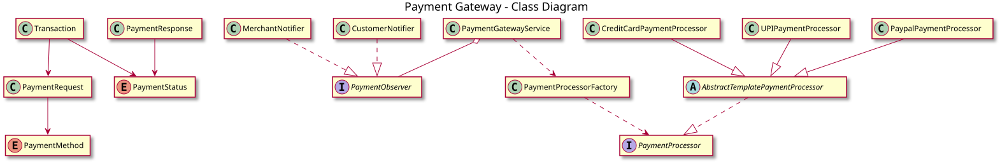

# Payment Gateway — LLD Documentation

## 1. Requirement Gathering

Design a **payment gateway** that supports multiple payment methods and tracks each payment transaction.

- A customer initiates a payment by providing payer details, merchant details, amount, currency, payment method, and payment-specific details.
- The system supports **Credit Card, UPI, and PayPal** payments.
- The system should include retries.
- The system notifies merchant and customer
- Payment processing failures are handled gracefully, and the transaction is marked as `FAILED`.

---

## 2. Requirements

### Functional Requirements

1. Accept payment requests containing an idempotency key, payer ID, merchant ID, amount, currency, payment method, and payment details.
2. Support Credit Card, UPI, and PayPal payment methods.
3. Create a transaction for each payment request with a unique transaction ID and initial status `INITIATED`.
4. Process payments through the processor corresponding to the selected payment method.
5. Retry failed payment attempts up to a configured maximum of three attempts.
6. Update the transaction status to `SUCCESS` or `FAILED` based on the processing result.
7. Notify registered observers whenever the transaction status changes.
8. Allow observers to be registered and removed dynamically.

### Non-Functional Requirements

1. **Extensibility:** New payment methods should be supported with minimal changes to existing code.
2. **Reliability:** Payment processing failures should not leave a transaction indefinitely in the `INITIATED` state.
3. **Idempotency:** Repeated requests with the same idempotency key should not result in duplicate charges.
4. **Maintainability:** Payment processing, transaction management, and notifications should remain separate responsibilities.
5. **Security:** Sensitive payment details must be protected and should not be logged or exposed in notifications.

---

## 3. Use Cases

### Process Payment

**Input:** `PaymentRequest`

**Flow:**

1. The client submits a payment request to `PaymentGatewayService`.
2. The service creates a `Transaction` with a unique ID and status `INITIATED`.
3. `PaymentProcessorFactory` selects the processor based on the payment method.
4. The selected processor executes the payment using the common retry workflow.
5. The processor returns a `PaymentResponse`.
6. The service updates the transaction status based on the response.
7. Registered observers are notified of the status update.
8. The service returns the final `Transaction`.

**Failure flow:**

- If payment processing returns `FAILED`, the processor retries up to three total attempts.
- If processing throws an exception, the service marks the transaction as `FAILED`.
- Observers are notified of the final status update.

**Output:** `Transaction` containing the transaction ID, payment request, and final status.

---

## 4. Core Design

| Component | Responsibility |
|---|---|
| `PaymentRequest` | Holds payment input, including payer, merchant, amount, currency, payment method, and idempotency key. |
| `PaymentResponse` | Represents the payment processing status and message. |
| `Transaction` | Tracks the transaction ID, request, status, and creation timestamp. |
| `PaymentMethod` | Enum defining `CREDIT_CARD`, `UPI`, and `PAYPAL`. |
| `PaymentStatus` | Enum defining `INITIATED`, `SUCCESS`, and `FAILED`. |
| `PaymentProcessor` | Interface defining the payment processing contract. |
| `AbstractTemplatePaymentProcessor` | Implements the common payment processing and retry workflow. |
| `CreditCardPaymentProcessor` | Processes credit card payments. |
| `UPIPaymentProcessor` | Processes UPI payments. |
| `PaypalPaymentProcessor` | Processes PayPal payments. |
| `PaymentProcessorFactory` | Selects the appropriate processor for a payment method. |
| `PaymentObserver` | Defines the contract for transaction status notifications. |
| `MerchantNotifier` | Notifies merchants about transaction status updates. |
| `CustomerNotifier` | Notifies customers when payments succeed. |
| `PaymentGatewayService` | Coordinates transaction creation, processor selection, status updates, and observer notifications. |

### Design Patterns

- **Strategy Pattern:** `PaymentProcessor` provides a common contract for different payment processing implementations.
- **Template Method Pattern:** `AbstractTemplatePaymentProcessor` defines the shared processing and retry workflow while subclasses implement `doPayment()`.
- **Factory Pattern:** `PaymentProcessorFactory` selects the correct processor for the requested payment method.
- **Observer Pattern:** `PaymentObserver` enables notification handlers to react to transaction status changes.

---

## 5. Class Diagram

**Source:** [diagrams/class-diagram.puml](diagrams/class-diagram.puml) — The SVG is generated automatically by the PlantUML GitHub Action at the repository root.
